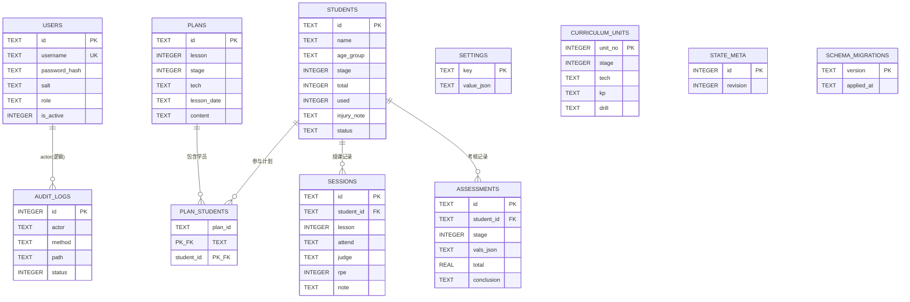

# 数据模型（ER 图与数据字典）

数据库：SQLite，文件 `data/pickleball.db`，WAL 模式，外键开启。迁移脚本：`database/migrations/001_init.sql`。

## 1. ER 图

> `audit_logs.actor` 记录账号名，为逻辑关联（不设物理外键，避免删账号影响审计）。

## 2. 数据字典（核心字段）

### students 学员档案

| 列 | 类型 | 约束 | 说明 |
|---|---|---|---|
| `id` | TEXT | PK | 前端 `uid()` 生成，聚合同步时保留 |
| `name` | TEXT | NOT NULL | 姓名 |
| `age_group` | TEXT | CHECK adult/youth/senior/mixed | 年龄段，驱动教案分层 |
| `stage` | INTEGER | CHECK 1–3 | 阶段：初学者 / 进阶 / 竞技 |
| `total` / `used` | INTEGER | — | 总课次 / 已耗课次，剩余用于续费预警 |
| `injury_note` | TEXT | — | 伤病记录；非空即触发安全提示 |
| `status` | TEXT | — | 在训 / 待考 / 结业 |
| `deleted_at` | TEXT | NULL = 有效 | 软删除 |

### plans 教学计划

| 列 | 类型 | 说明 |
|---|---|---|
| `lesson` | INTEGER | 课次 1–48（CHECK） |
| `stage` | INTEGER | 1–3 |
| `content` | TEXT | 教案全文（六环节详细内容） |
| `zones_json` | TEXT | 本课次启用的分区数组 |
| `age_name` / `class_size` | TEXT | 年龄段显示名 / 班型 |

### plan_students 计划与学员

复合主键 `(plan_id, student_id)`，双外键级联。**多人班多选学员**落在这张表，避免把学员 ID 塞进 JSON 字符串。

### sessions 授课记录

`attend`（出勤/请假/缺勤）、`judge`（达标/部分达标/未达标）、`rpe`（1–10）、`note`（1 条优点 + 1 条改进点）。`student_name` 不冗余存储，查询时 JOIN 派生。

### assessments 考核记录

`vals_json` 存 7 项实测值；`total` 为判定总分；`conclusion` 为晋级 / 补考 / 无法判定。**阈值未校准时不得给出晋级结论**。

### settings / curriculum_units / state_meta

| 表 | 内容 |
|---|---|
| `settings` | `thresholds`（P50/P75/P90、权重、晋级线）、`defaults`（默认假设）、`prefs`（界面偏好）、`meta`（演示标记） |
| `curriculum_units` | 24 教学单元 × 2 课次 = 48 课次；字段含技术主题、A/B 课重点、体能/步伐、组织、对抗、作业、错误纠正、关键判据、分解练习 |
| `state_meta` | 单行 `revision`，聚合同步与细粒度 CRUD 共用一把乐观锁 |

## 3. 索引与完整性

| 索引 | 用途 |
|---|---|
| `idx_students_name` / `idx_students_stage` | 档案搜索与阶段筛选 |
| `idx_plans_lesson` / `idx_plans_date` | 课次查询与近 7 日统计 |
| `idx_sessions_student_id` / `idx_sessions_date` | 学习记录聚合与出勤率 |
| `idx_assessments_student_id` | 考核历史 |
| `idx_plan_students_student` | 反查某学员参与的全部计划 |
| `idx_audit_logs_created_at` | 审计清理与检索 |
| `uk_users_username` | 用户名唯一（带 `deleted_at IS NULL` 条件） |

- 每张业务表含 `created_at` / `updated_at` / `deleted_at`。
- 枚举值使用 CHECK 约束而非数据库 ENUM 类型。
- 外键显式声明，写入顺序：students → plans → plan_students → sessions → assessments。
